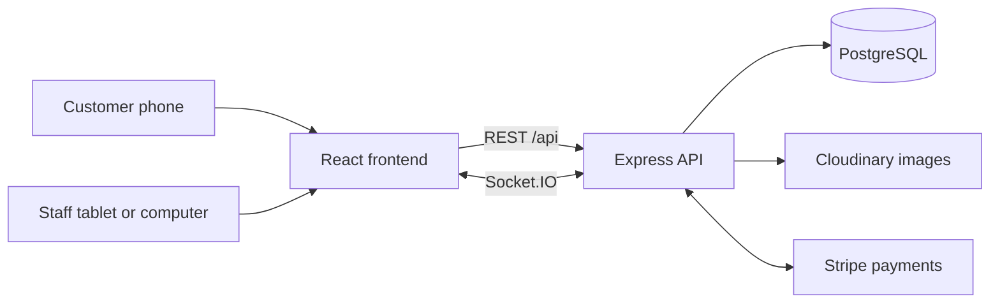
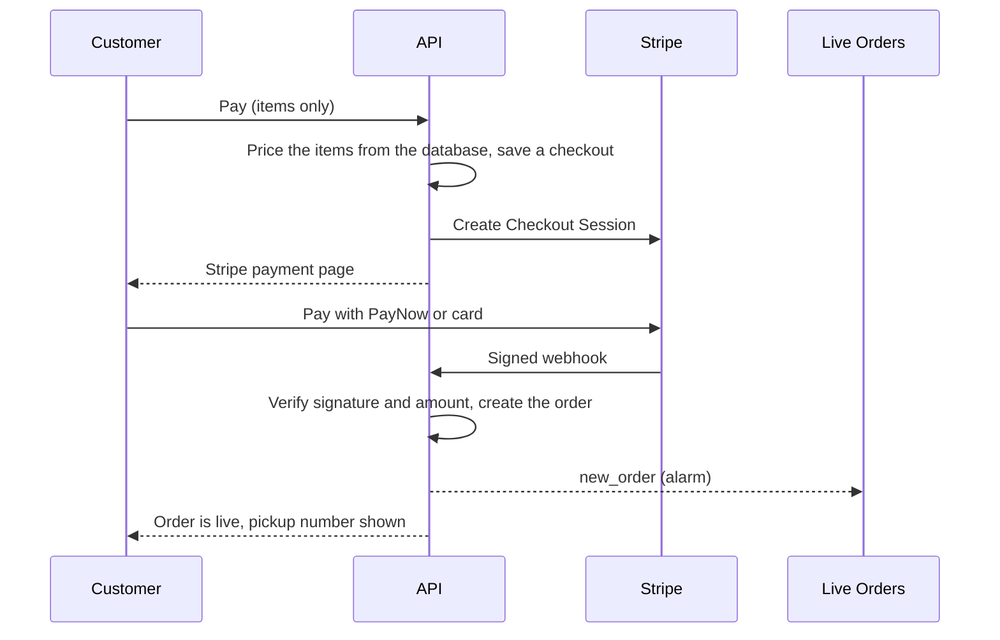
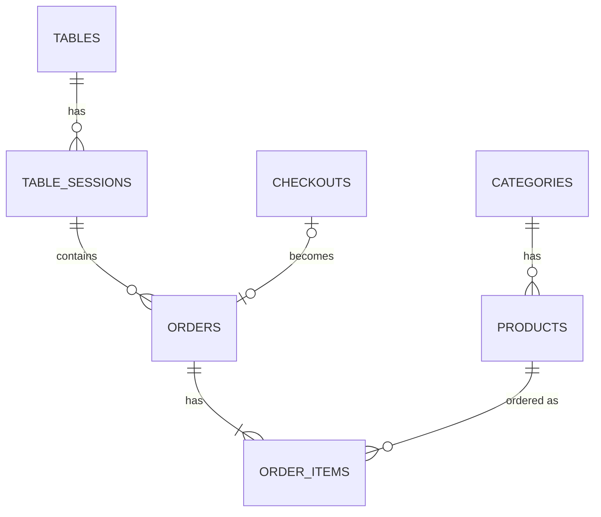

# Architecture

## Overview

The frontend is a single React app with two sides: customer pages (`/menu`, `/cart`, `/order/...`, `/session-orders`) and admin pages (`/admin/...`). The backend is one Express API with a Socket.IO server on the same port.

## Main flows

### Dine-in

1. The customer scans a table's QR code and opens `/menu?table=<qrToken>`.
2. The first order locks the table row, creates a **table session** (only one open session per table), marks the table occupied, and creates the order as `PENDING`.
3. The admin board receives `new_order` and rings.
4. Staff move the order through `PREPARING`, `READY` and `COMPLETED` (served). The customer sees each step live.
5. Staff take cash against the bill. The server calculates the total and checks that the cash covers it. When every order is served and the bill is paid, staff close the session and the table is free again.

### Takeaway, pay at the counter

The order is created immediately with a pickup number. The number restarts at 1 each day and is handed out under a database lock, so two simultaneous orders never get the same one. Staff record payment on the Takeaway orders page.

### Takeaway, online payment (optional)

Until the webhook arrives, the order does not exist, so the kitchen, the alarm, history and revenue never see an unpaid order.

## Rules the code relies on

- **The server sets every price.** The browser sends product ids and quantities only. Each order item stores `unitPrice` and `subtotal`, and each order stores `taxRate`, so later price or rate changes never alter old orders.
- **Menu prices include tax.** Customers pay the menu price. Tax shown on receipts is `total × rate ÷ (100 + rate)`, calculated per order.
- **Cancelled orders stay on record** but never count toward a bill, a receipt or revenue.
- **One open session per table**, enforced by a row lock in `createOrder` and a partial unique index in the database.
- **Public order pages use private 32-character tokens**, never numeric ids, so orders can't be found by guessing.
- **Online payments are confirmed only by Stripe's signed webhook.** The amount and currency are checked against the saved checkout, repeated deliveries are ignored, and a background job catches any webhook that was missed.
- **Roles are checked against the database on every request**, so a deleted or demoted user loses access immediately.

## Real time

| Event | Sent to | When |
|---|---|---|
| `new_order` | `admin_room` | An order is created or an online payment is confirmed |
| `order_updated` | `admin_room` | Status change, cancel or payment |
| `order_status_updated` | `order_<id>` and `token_<token>` | The customer's own order changed |
| `session_order_updated` | `session_<id>` | An order in a table's session changed |
| `tables_changed` | `admin_room` | A bill was paid or a session was closed |

Staff are placed in `admin_room` when they connect, and only if their login token is valid. Customers join their own room by proving they know the order's private token or the table's QR token. Rooms are lost whenever a connection drops, so every page rejoins and reloads on `connect`.

## Background jobs

| Job | Runs | What it does |
|---|---|---|
| Close idle sessions | Every 5 minutes | Closes a session with no live orders: empty ones after 60 minutes, paid ones after 30 minutes idle. A session with an unpaid bill is never closed. |
| Reconcile checkouts | Every minute | Asks Stripe about pending checkouts older than 2 minutes. It creates orders for paid sessions whose webhook was missed, and expires abandoned ones. |

## Data model

- `settings` always has exactly one row (id 1).
- `checkouts` holds a takeaway cart while it waits for payment.
- `users` is separate. Customers have no accounts.

## Security

Helmet headers, bcrypt password hashing, JWT login (1 day), role checks on every route, input validation, and a raw request body for the Stripe webhook so its signature can be verified. Rate limits: 10 failed logins per 15 minutes, 60 orders per 10 minutes per connection, and 1500 API requests per 15 minutes.

## Changing the database

Add a numbered file in `backend/src/migrations`, register it in `migrations/index.ts`, and restart. Never edit a migration that has already run. The app does not use `sequelize.sync()`.